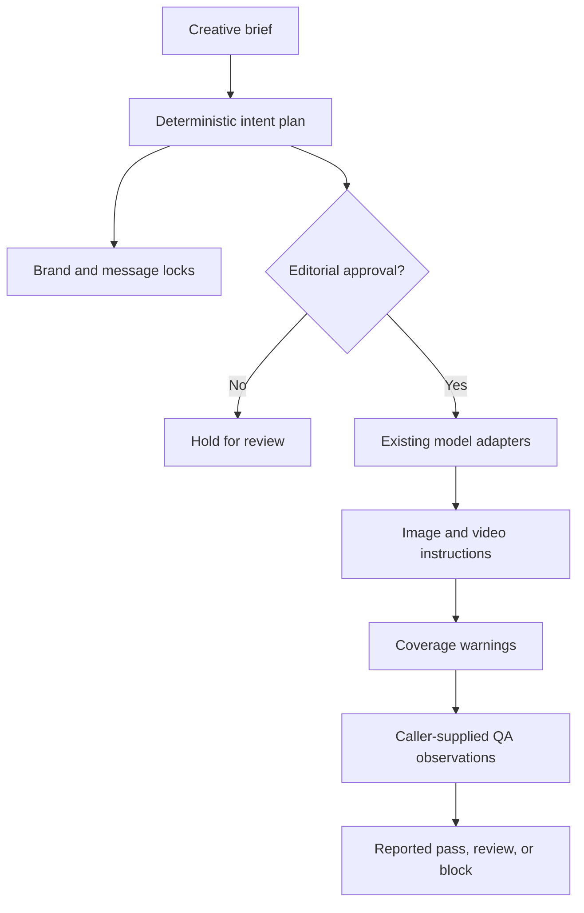

# Creative Intent Engine

## A shared creative contract for more than one model

A multi-format campaign should not become unrelated prompts for each image and video generator. The Creative Intent Engine converts one approved advertising brief into **shared, inspectable requirements** and model-specific compilation tasks. It reuses Designly's existing Python adapters. It does not call generation APIs or claim to inspect finished media.

The initial release is an intentionally small TypeScript API, designed to make planning, compilation, and later evidence-based review separate decisions.



## 1. Plan

`createCreativeIntentPlan(brief)` requires a campaign ID, brand, objective, subject, key message, and at least one target. It rejects unknown models, ratios unsupported by the chosen adapter, duplicate target IDs, empty identity locks, and invalid video duration.

The plan contains:

- `locks`: the shared brand, key message, exact copy (if supplied), ordered visual anchors, and prohibited elements. Every lock declares whether the requirement should be present or absent in the resulting media.
- `tasks`: one independently compiled specification per target, retaining a common subject, objective, brand, anchors, and prohibited elements.
- `status: "review_required"`: a plan is *not* creative approval.

Input briefs are not mutated. Aspect-ratio support comes from Designly's public adapter registry. This checks a declared model contract, not the capabilities of a live provider endpoint.

## 2. Compile after editorial approval

`compileCreativeIntentPlan(plan, { decision: "approved", reviewer: "..." })` invokes the existing prompt compiler for every target and returns model-ready **text instructions**.

The approval object records a caller-declared editorial decision. **It does not authenticate the reviewer.** Applications needing authorization should verify the reviewer's identity and authorization outside this library.

Each output includes `missingLockIds`, derived by checking whether the compiler output still mentions each exact locked value. An adapter that omits required packshot copy or an exclusion instruction produces `status: "needs_review"` rather than a fabricated green light. A `status: "compiled"` means only that the prompt text mentions all literal lock values, including prohibited elements as instructions to avoid. It does not mean the model will render the scene correctly.

## 3. Review observed media

`evaluateCreativeIntent(plan, observations)` operates on **caller-supplied** evidence rather than pixels or video frames. Every observation names a target, a source, and a map of lock IDs to `true`, `false`, or `null`:

```ts
const observations = [{
  taskId: "portrait",
  source: "editorial-qa-01",
  checks: {
    brand: true,
    key_message: true,
    exact_copy: false,
    visual_anchor_1: true,
    visual_anchor_2: true,
    visual_anchor_3: true,
    avoid_1: true,
    avoid_2: true
  }
}];
```

The evaluation returns a finding for *every* lock on *every* target:

| Output status | Meaning |
| --- | --- |
| `blocked` | At least one observation explicitly reports a failed requirement. |
| `needs_review` | No reported failure, but at least one target/requirement lacks evidence. |
| `reported_pass` | Every required lock is explicitly marked true by the supplied observations. |

`reported_pass` is **not independent verification**. Every report includes `scope: "caller_supplied_observations"`; only the system supplying observations can justify their provenance and accuracy. Unknown task IDs, unknown lock IDs, duplicate observations, and invalid check values are rejected.

For an `avoid_*` lock, `true` means the reviewer reports that the prohibited item is **absent** from the observed asset. It does not mean the unwanted item should appear in the prompt as positive scene content.

## Reproduce the demo

From the repository root:

```bash
bun install --frozen-lockfile
bun run build
bun examples/creative-intent-demo.ts
bun test tests/creative-intent.test.ts
```

The demo uses a fictitious amber-fragrance brief, prepares GPT Image 2 and Veo instructions, and deliberately supplies **no** media observations. The final report therefore says `needs_review`, even though prompt compilation can succeed.

The demo does not make paid model requests. Python 3 is required to run Designly's existing compiler.

## Product boundaries and next research

1. **Creative approval** is an editorial boundary; caller-provided reviewer metadata is not an access-control system.
2. **Prompt coverage** is a literal text-presence check, not semantic correctness or a promise of typography fidelity.
3. **Visual QA** needs a real asset evaluator or a human reviewer that can return documented observations. Until then, unobserved checks remain unverified.
4. **Model compatibility** currently follows the declared local registry. Live model versions, pricing, and limits are outside this offline engine.
5. Future adapters can contribute richer typed requirements and media-evaluation evidence, without changing the distinction between a plan, compiled instructions, and verified results.

These boundaries are deliberate. They keep the current implementation useful for prototyping multi-model creative workflows without misrepresenting what an offline planner can prove.
